<div align="center">

# CampusSafeHer
### A Smart Campus Safety Platform for Female University Students

**Emergency assistance · Trusted circles · Journey check-ins · Incident reporting · AI safety guidance**

[](https://react.dev/) [](https://nodejs.org/) [](https://www.mongodb.com/atlas) [](#)

**[ Live Application](https://campus-safe-her.vercel.app)** · **[Source Code](https://github.com/WaraniLakma/CampusSafeHer)**

</div>

---

## 📖 Table of Contents

- [Overview](#-overview)
- [Features](#-features)
- [CRUD Implementation](#-crud-implementation)
- [Technology Stack](#-technology-stack)
- [University Demo Accounts](#-university-demo-accounts)
- [System Architecture](#-system-architecture)
- [Database Design and ERD](#-database-design-and-erd)
- [Installation and Local Setup](#-installation-and-local-setup)
- [Deployment](#-deployment)
- [Application Screenshots](#-application-screenshots)

## Overview

**CampusSafeHer** is a full-stack MERN web application developed to support the personal safety of female university students. It combines emergency SOS alerts, registered trusted contacts, journey safety timers, incident reporting, and AI-powered guidance in one student-friendly platform. A separate administrator portal helps campus staff review and manage reported incidents.

The system uses **MongoDB Atlas** for persistent storage and **Mongoose** to define application data models and references.


## Features

| Module | Student / Administrator functionality |
|---|---|
| Authentication | Student registration and login; separate administrator access; JWT-based sessions and password hashing |
| Emergency SOS | Create an SOS alert containing GPS coordinates; notify registered trusted contacts |
| Trusted Circle | Add registered users as trusted contacts, view the circle, and remove contacts |
| Journey Check-Ins | Set a destination, expected arrival time, and reminder interval; confirm safe arrival; trigger overdue alerts |
| Incident Reporting | Submit categorized incidents with locations and descriptions; optional anonymity and supporting evidence; view and remove reports |
| Safety Alerts | View incoming SOS and check-in notifications, including location actions and dismiss controls |
| AI Safety Assistant | Ask campus-safety questions and request guidance or complaint-letter drafts using Google Gemini |
| Admin Console | Review submitted incidents, filter/search reports, and update incident resolution status |


### Feature and component breakdown

| Interface / Component | Responsibility | Related database collection |
|---|---|---|
| **Student Registration & Login** | Create student accounts, authenticate existing users, and start authorized sessions | `users` |
| **Role Selection & Admin Login** | Direct students and administrators to their respective authentication workflows | `users` |
| **Student Dashboard** | Display SOS action, check-in count, incident count, alert count, and trusted-circle summary | `sos`, `checkins`, `incidents`, notification collections, `trustedcontacts` |
| **Trusted Circle Management** | Add registered contacts by email, list contacts, and remove saved relationships | `trustedcontacts`, `users` |
| **Incident Reporting Center** | Submit incident details and evidence, view filed reports, and remove reports | `incidents` |
| **Incident Command Center** | Search/filter reported incidents and change review/resolution status | `incidents` |
| **Journey Safety Check-Ins** | Create a journey timer, display existing journeys, confirm arrival, and delete a check-in | `checkins` |
| **Safety Alerts Inbox** | Show incoming SOS and check-in notifications with location links and dismiss controls | `sosnotifications`, `checkinnotifications` |
| **AI Safety Assistant** | Request safety advice, emergency guidance, and complaint-letter drafts | Google Gemini API (not represented as a persistent collection in the ERD) |

**Student workflow:** Register / Sign in → Manage trusted contacts → Activate SOS or check-in → Receive and review safety alerts → Submit and track incidents.

**Administrator workflow:** Sign in → View incident queue → Filter/search cases → Update incident status.


## CRUD Implementation

**CRUD** stands for **Create, Read, Update, and Delete**. CampusSafeHer implements these operations across its MongoDB collections through RESTful APIs developed using Node.js and Express.js.

| CRUD Operation | What is Assessed? | Implementation in CampusSafeHer |
|---|---|---|
| **1. Create** | Adding new records through forms and API requests. | Student registration (`POST /api/auth/register`), adding trusted contacts (`POST /api/contacts`), submitting incident reports (`POST /api/incidents`), creating safety check-ins (`POST /api/checkins`), and triggering emergency SOS alerts (`POST /api/sos`). |
| **2. Read** | Retrieving, listing, and displaying stored records. | Viewing user profiles, trusted contacts, incident reports, safety check-ins, and safety notifications through `GET` endpoints. Administrators can retrieve all incident reports using `GET /api/admin/incidents`. |
| **3. Update** | Modifying existing records and updating their status. | Administrators update incident statuses (`PATCH /api/admin/incidents/:id`). Students complete check-ins (`PATCH /api/checkins/:id`), update GPS locations (`PUT /api/checkins/:id/location`), and resolve SOS alerts (`PATCH /api/sos/:id/resolve`). |
| **4. Delete** | Removing existing records through authorized API requests. | Deleting trusted contacts (`DELETE /api/contacts/:id`), incident reports (`DELETE /api/incidents/:id`), safety check-ins (`DELETE /api/checkins/:id`), and SOS/check-in notifications through their respective `DELETE` endpoints. |

> **Note:** CRUD operations are implemented according to each feature's requirements. Not every MongoDB collection exposes all four operations.


###  RESTful API endpoint specification


| Route file | Method | Full API path | Operation | Purpose | Access |
|---|---|---|---|---|---|
| `authRoutes.js` | `POST` | `/api/auth/register` | Create | Register account | Public |
| `authRoutes.js` | `POST` | `/api/auth/login` | Auth | Login and receive authentication response | Public |
| `authRoutes.js` | `GET` | `/api/auth/profile` | Read | Retrieve current user profile | Protected |
| `contactRoutes.js` | `POST` | `/api/contacts` | Create | Add trusted contact | Protected |
| `contactRoutes.js` | `GET` | `/api/contacts` | Read | List trusted contacts | Protected |
| `contactRoutes.js` | `DELETE` | `/api/contacts/:id` | Delete | Remove trusted contact | Protected |
| `incidentRoutes.js` | `POST` | `/api/incidents` | Create | Submit incident | Protected |
| `incidentRoutes.js` | `GET` | `/api/incidents` | Read | List own incidents | Protected |
| `incidentRoutes.js` | `DELETE` | `/api/incidents/:id` | Delete | Remove incident | Protected |
| `adminRoutes.js` | `GET` | `/api/admin/incidents` | Read | List all incidents | Admin |
| `adminRoutes.js` | `PATCH` | `/api/admin/incidents/:id` | Update | Update incident status | Admin |
| `checkInRoutes.js` | `POST` | `/api/checkins` | Create | Create journey check-in | Protected |
| `checkInRoutes.js` | `GET` | `/api/checkins` | Read | List own check-ins | Protected |
| `checkInRoutes.js` | `PATCH` | `/api/checkins/:id` | Update | Complete check-in | Protected |
| `checkInRoutes.js` | `PUT` | `/api/checkins/:id/location` | Update | Update check-in location | Protected |
| `checkInRoutes.js` | `DELETE` | `/api/checkins/:id` | Delete | Remove check-in | Protected |
| `checkInRoutes.js` | `GET` | `/api/checkins/notifications` | Read | Get check-in notifications | Protected |
| `checkInRoutes.js` | `DELETE` | `/api/checkins/notifications/:id` | Delete | Dismiss/delete check-in notification | Protected |
| `sosRoutes.js` | `POST` | `/api/sos` | Create | Trigger SOS | Protected |
| `sosRoutes.js` | `PATCH` | `/api/sos/:id/resolve` | Update | Resolve SOS | Protected |
| `sosRoutes.js` | `GET` | `/api/sos/notifications` | Read | Get SOS notifications | Protected |
| `sosRoutes.js` | `DELETE` | `/api/sos/notifications/:id` | Delete | Dismiss/delete SOS notification | Protected |
| `aiRoutes.js` | `POST` | `/api/ai/chat` | AI action | Submit AI chat request | Protected |
| `healthRoutes.js` | `GET` | `/api/health` | Health check | Check API availability | Public |

**Note:** `Protected` indicates `protect` middleware, and `Admin` indicates both `protect` and `adminOnly`. Request body fields and response formats should be confirmed from the controllers.### 📊 CRUD operations by feature

| CRUD operation | CampusSafeHer implementation | User-facing evidence | Main collections |
|---|---|---|---|
| **Create** | Registration, adding trusted contacts, filing incidents, starting check-ins, triggering SOS | Registration form, Add to Trusted Circle, Submit Incident Report, Activate Check-In, SEND SOS | `users`, `trustedcontacts`, `incidents`, `checkins`, `sos` |
| **Read** | Display trusted circle, check-in history, incident lists, administrator queue, and incoming alerts | Dashboard, Trusted Contacts, Incident Reporting, Incident Command Center, Safety Alerts | All seven main collections, as applicable |
| **Update** | Change incident investigation status; confirm safe arrival and update check-in state | Admin status buttons; I've Arrived Safely | `incidents`, `checkins` |
| **Delete** | Remove trusted contacts, submitted incidents, and check-ins | Trash/remove controls on the corresponding screens | `trustedcontacts`, `incidents`, `checkins` |

*This table describes the demonstrated workflows, not full CRUD support for every collection.*

### CRUD workflows

**1. Trusted contact management**

1. **Create:** A student enters the registered email of another user and selects a relationship.
2. **Read:** The trusted circle displays saved contacts.
3. **Delete:** The student removes a contact from the circle.
4. **Data relationship:** `trustedcontacts.user` and `trustedcontacts.trustedUser` refer to `users` documents.

**2. Incident management**

1. **Create:** A student submits a category, description, location, and optionally an attachment or anonymous flag.
2. **Read:** The student sees submitted reports; administrators see the incident queue.
3. **Update:** An administrator moves a report between statuses such as **Pending**, **Under Review**, and **Resolved**.
4. **Delete:** The student interface provides a delete action for filed reports.
5. **Data relationship:** `incidents.user` refers to the reporting user's document.

**3. Safety check-in management**

1. **Create:** A student selects a destination, expected arrival time, and reminder interval.
2. **Read:** The check-in dashboard displays existing journeys and their states.
3. **Update:** Arrival confirmation or reminder processing changes check-in status and notification flags.
4. **Delete:** The student can remove a check-in using the displayed Delete action.
5. **Data relationship:** `checkins.user` refers to `users`; `checkinnotifications.checkIn` refers to `checkins`.

**4. Emergency SOS and notifications**

1. **Create:** Pressing **SEND SOS** records an alert with latitude and longitude.
2. **Read:** Trusted recipients can view SOS notifications and access the shared location.
3. **Notification records:** `sosnotifications` links a sender, receiver, and SOS record.
4. **Scope:** SOS creation and notification retrieval are demonstrated; full update/delete behavior is not claimed.


### Example data flow: Incident status update

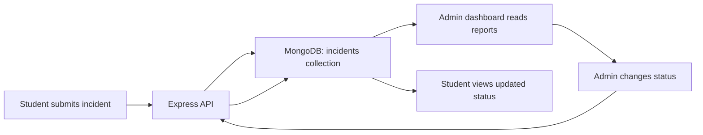


## Technology Stack

| Layer | Technologies |
|---|---|
| Frontend | React, Vite, React Router DOM, Axios |
| Backend | Node.js, Express.js |
| Database | MongoDB Atlas, Mongoose |
| Authentication | JWT, bcryptjs |
| AI | Google Gemini API |
| Background scheduling | Node Cron |
| Configuration | dotenv, CORS |
| Version control | Git, GitHub |
| Deployment | Vercel (frontend), Render (backend configuration) |


### External packages and dependencies

Versions below are the **declared package.json ranges**, not necessarily the exact installed lockfile versions.

**Frontend — `frontend/package.json` (runtime dependencies)**

| Package | Declared version | Purpose |
|---|---|---|
| `axios` | `^1.17.0` | HTTP client |
| `react` | `^19.2.6` | UI components |
| `react-dom` | `^19.2.6` | React DOM rendering |
| `react-router-dom` | `^7.17.0` | Client-side navigation |

**Frontend — development dependencies**

| Package | Declared version | Purpose |
|---|---|---|
| `@eslint/js` | `^10.0.1` | ESLint JavaScript rules |
| `@types/react` | `^19.2.14` | React type declarations |
| `@types/react-dom` | `^19.2.3` | React DOM type declarations |
| `@vitejs/plugin-react` | `^6.0.1` | React support in Vite |
| `eslint` | `^10.3.0` | Code linting |
| `eslint-plugin-react-hooks` | `^7.1.1` | React Hooks linting |
| `eslint-plugin-react-refresh` | `^0.5.2` | Fast Refresh linting |
| `globals` | `^17.6.0` | ESLint global definitions |
| `vite` | `^8.0.12` | Development server and build tooling |

**Backend — `backend/package.json`**

| Package | Declared version | Purpose |
|---|---|---|
| `@google/genai` | `^2.8.0` | Google Gemini AI SDK |
| `bcryptjs` | `^3.0.3` | Password hashing |
| `cors` | `^2.8.6` | Cross-origin resource sharing |
| `dotenv` | `^17.4.2` | Environment variable loading |
| `express` | `^5.2.1` | HTTP API and routing |
| `jsonwebtoken` | `^9.0.3` | JWT creation and validation |
| `mongoose` | `^9.7.0` | MongoDB models and queries |
| `node-cron` | `^4.2.1` | Scheduled jobs |

**External services**

| Service | Role |
|---|---|
| MongoDB Atlas | Hosted MongoDB database |
| Google Gemini API | AI safety assistance |
| Vercel | Frontend deployment |
| Render | Backend deployment target |

## System Architecture

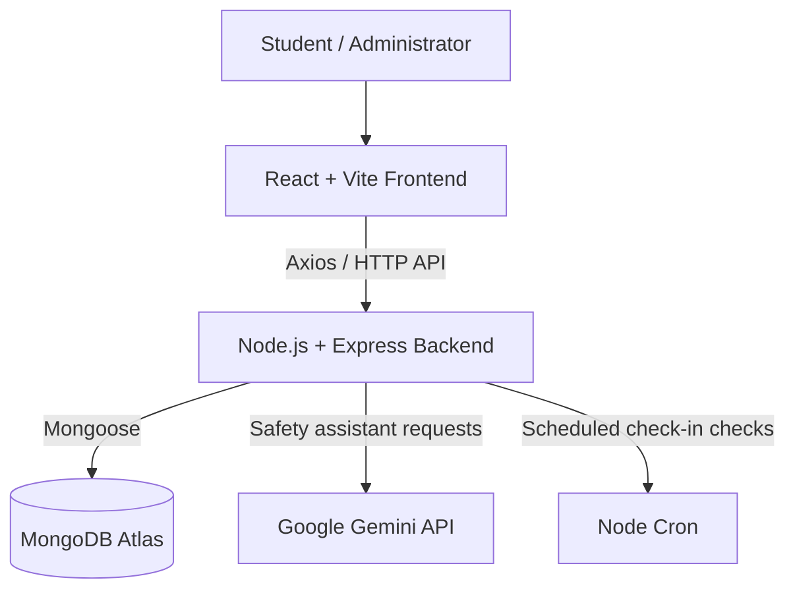

The frontend sends requests to the backend's `/api` routes. `server.js` enables JSON parsing, allows CORS requests from `http://localhost:5173` and `https://campus-safe-her.vercel.app`, connects to MongoDB, and starts the check-in monitor. The backend validates requests, handles authentication and safety workflows, and persists records in MongoDB Atlas.


### Project folder and file architecture

This tree lists **verified uploaded backend route filenames** and the known project directories. Other subdirectories remain partially documented because a full repository tree was not supplied.

```text
CampusSafeHer/
├── README.md                         # GitHub documentation
├── screenshots/                      # UI captures and MongoDB ERD
│   └── CampusSafeHer_ERD.png         # Moon Modeler schema diagram
├── frontend/                         # React + Vite application
│   ├── package.json                  # Verified frontend dependencies
│   └── src/                          # React pages/components (names unverified)
└── backend/                          # Node.js + Express application
    ├── package.json                  # Verified backend dependencies
    ├── server.js                     # Express entry point; mounts /api routes and starts monitor
    ├── routes/                        # Uploaded route modules
    │   ├── authRoutes.js             # Registration, login, profile
    │   ├── contactRoutes.js          # Trusted-contact CRUD routes
    │   ├── incidentRoutes.js         # Student incident routes
    │   ├── adminRoutes.js            # Administrator incident review
    │   ├── checkInRoutes.js          # Check-ins and notifications
    │   ├── sosRoutes.js              # SOS and notification routes
    │   ├── aiRoutes.js               # Protected AI chat
    │   └── healthRoutes.js           # API health check
    ├── config/                       # db.js MongoDB connection module
    ├── services/                     # checkInMonitor.js scheduled monitoring
    ├── controllers/                  # Controller imports referenced in routes
    └── middleware/                   # Authentication and admin middleware
```

> `server.js` confirms the imported `config/db.js`, `services/checkInMonitor.js`, and eight route modules. The full frontend component tree still requires repository inspection. Never commit `.env` credentials or publish demo-account passwords.

## Database Design and ERD

The MongoDB database was reverse-engineered using **Moon Modeler**, producing a diagram of **7 collections and 11 references**. References are stored as MongoDB ObjectIds and resolved at the application level through Mongoose.

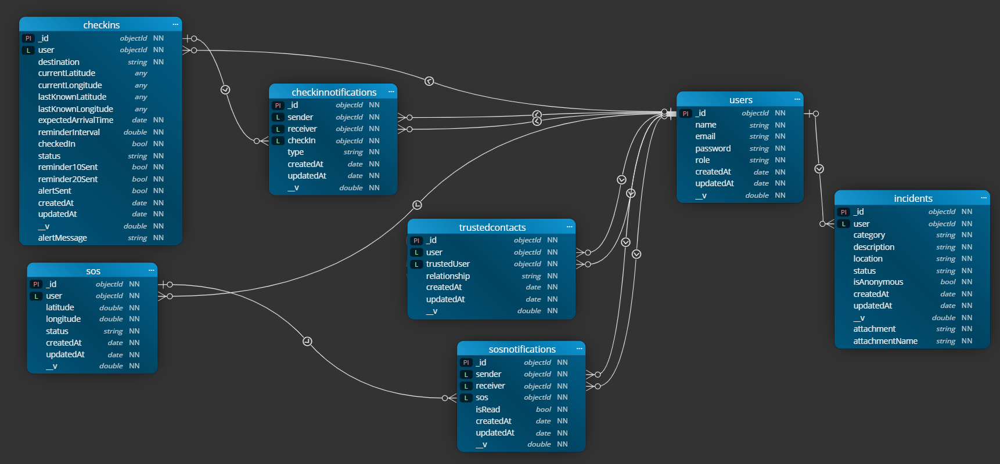

| Collection | Key fields | Role |
|---|---|---|
| `users` | `name`, `email`, `password`, `role` | Registered accounts and roles |
| `trustedcontacts` | `user`, `trustedUser`, `relationship` | Student-to-trusted-user relationships |
| `incidents` | `user`, `category`, `description`, `location`, `status`, `isAnonymous`, `attachment` | Incident submissions and review |
| `sos` | `user`, `latitude`, `longitude`, `status` | Emergency alert records |
| `checkins` | `user`, `destination`, `expectedArrivalTime`, `reminderInterval`, `status`, location/reminder fields | Journey monitoring |
| `sosnotifications` | `sender`, `receiver`, `sos`, `isRead` | SOS delivery records |
| `checkinnotifications` | `sender`, `receiver`, `checkIn`, `type` | Overdue and safe-arrival notifications |

**Principal relationships:** a user can create multiple incidents, SOS alerts, and check-ins; trusted-contact entries connect two users; notification documents reference their sender, receiver, and originating SOS/check-in record.


##  University Demo Accounts

CampusSafeHer provides separate **Student** and **Administrator** access flows for academic demonstration and testing. Account credentials are deliberately **not published in this public repository**.

| Role | Demonstration scope | Credential availability |
|---|---|---|
| **Student** | Register/sign in; manage trusted contacts; send SOS; create check-ins; file and view incident reports; receive alerts; use AI assistant | Documented privately in the university project report |
| **Administrator** | Sign in to the Incident Command Center; review, filter, and update incident statuses | Documented privately in the university project report |

> **Security note:** Demo account emails, passwords, JWT secrets, MongoDB connection strings, and API keys are excluded from this README. Authorized university evaluators can refer to the accompanying project report or obtain test credentials privately. Avoid placing real passwords in any publicly shared version of the report.

## Installation and Local Setup

### Prerequisites

- Node.js and npm
- Git
- MongoDB Atlas database and database-user credentials
- Google Gemini API key for AI functionality

### 1. Clone the project

```bash
git clone https://github.com/WaraniLakma/CampusSafeHer.git
cd CampusSafeHer
```

### 2. Configure and run the backend

```bash
cd backend
npm install
```

Create `backend/.env`:

```dotenv
MONGODB_URI=your_mongodb_connection_string
PORT=5000
# Also configure the JWT secret and Gemini API key using
# the exact environment-variable names referenced in the backend code.
```

```bash
npm start
```

### 3. Configure and run the frontend

In a **separate terminal** from the repository root:

```bash
cd frontend
npm install
```

Create `frontend/.env`:

```dotenv
VITE_API_URL=http://localhost:5000/api
```

```bash
npm run dev
```

Open the local URL shown by Vite (typically `http://localhost:5173`). To create a production frontend build, run `npm run build` from `frontend`.


## Deployment

| Component | Service |
|---|---|
| Frontend | Vercel |
| Backend | Render |
| Database | MongoDB Atlas |

**Live frontend:** https://campus-safe-her.vercel.app

When deploying, set `VITE_API_URL` to the public backend API URL, configure backend secrets securely, and allow the deployed frontend origin in backend CORS settings.

## Application Screenshots

### Public pages and authentication

**Landing page**


**Choose a portal**

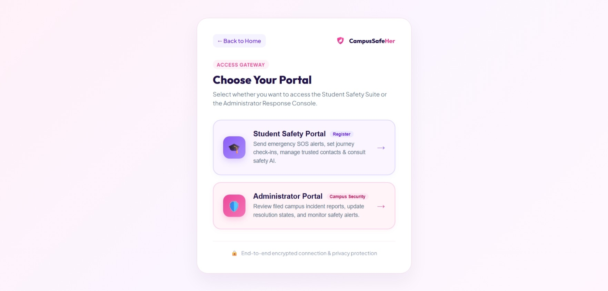

| Student sign-in | Student registration |
|---|---|
| 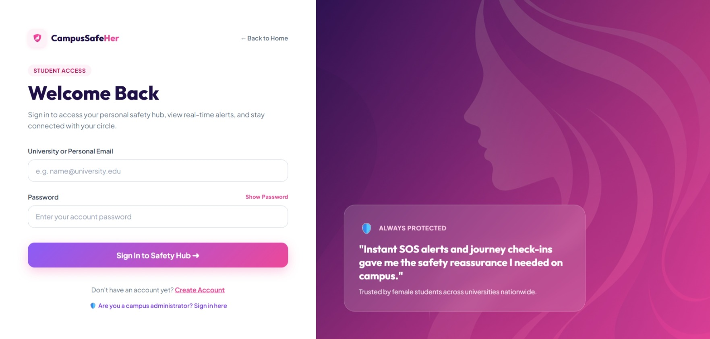 | 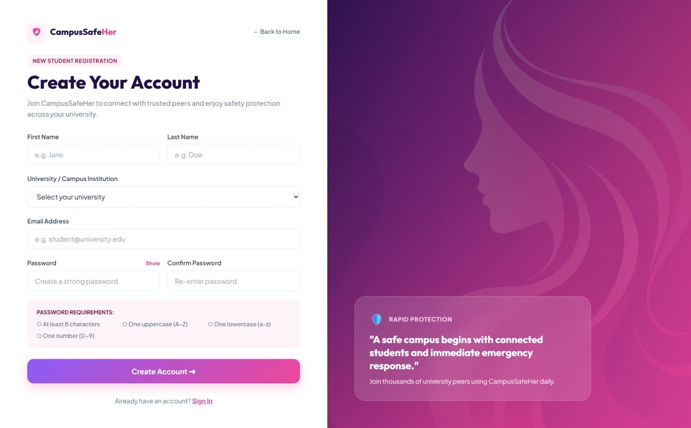 |

### Student safety dashboard


### Trusted contact CRUD

The trusted-circle screen supports adding registered users, viewing the saved circle, and removing contacts.

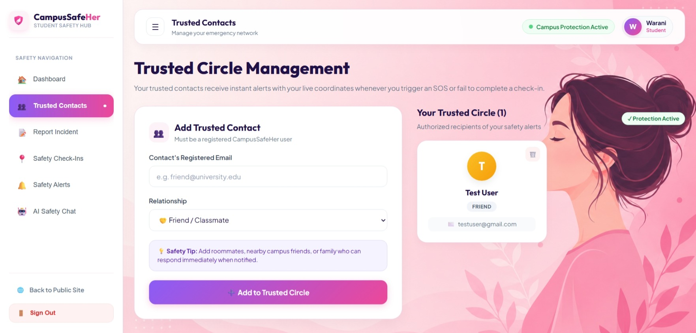

### Incident reporting and management

Students can submit reports, see status changes, and access delete controls for their reports.

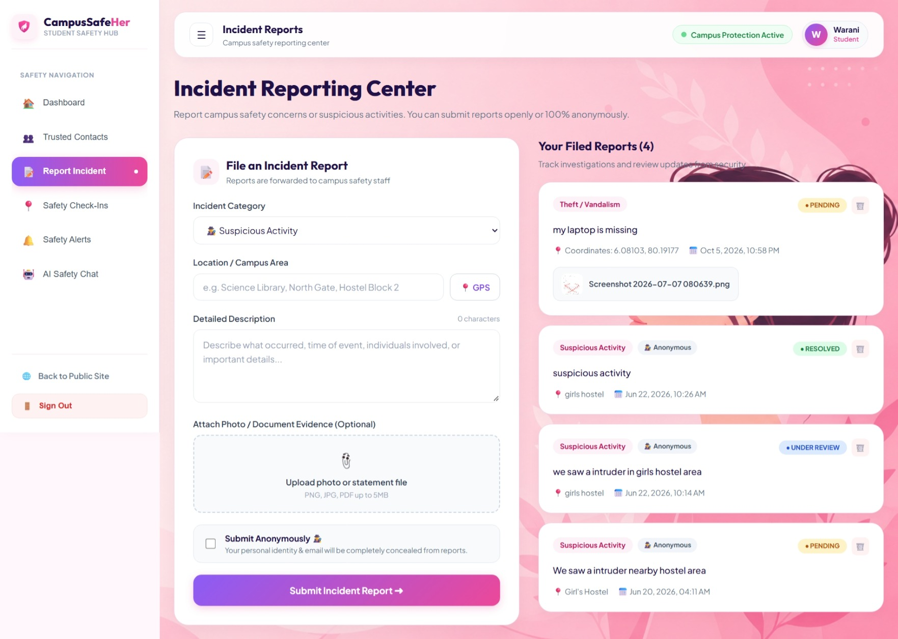

### Journey safety check-ins

The check-in interface displays destination entry, arrival timers, automatic overdue warnings, safe-arrival confirmation, and deletion controls.

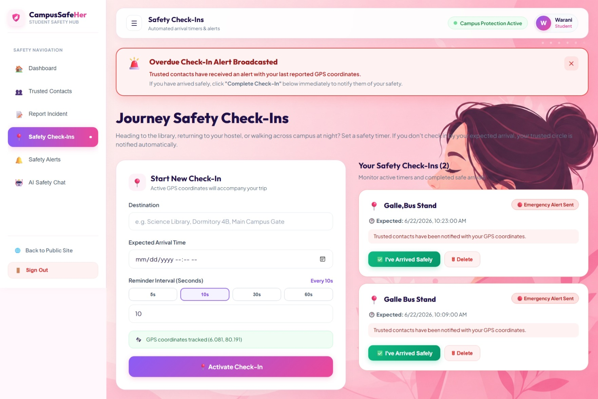

### Safety notifications

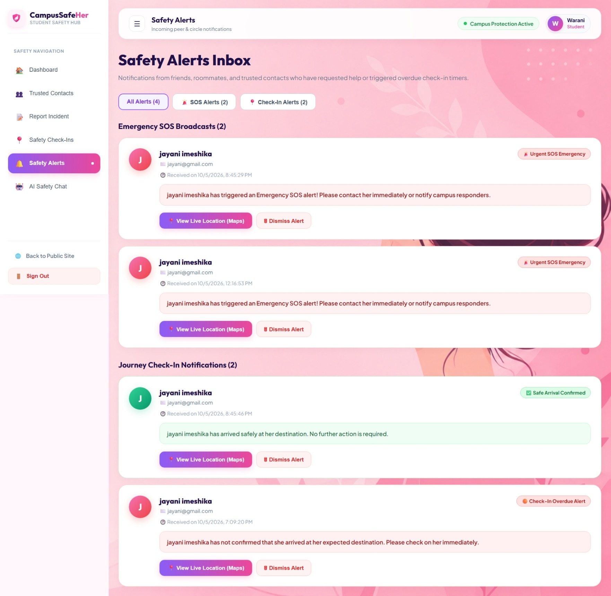

### AI safety assistant

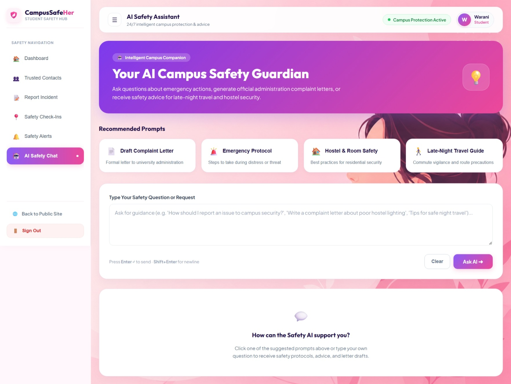

### Administrator portal

**Administrator sign-in**

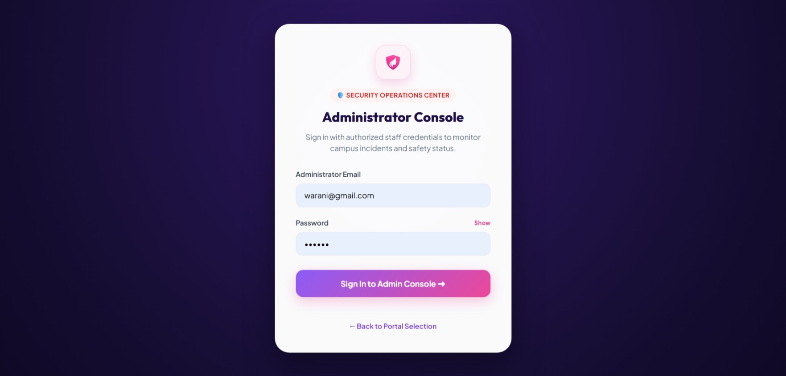

**Incident command center — report reading, filtering, and status updates**

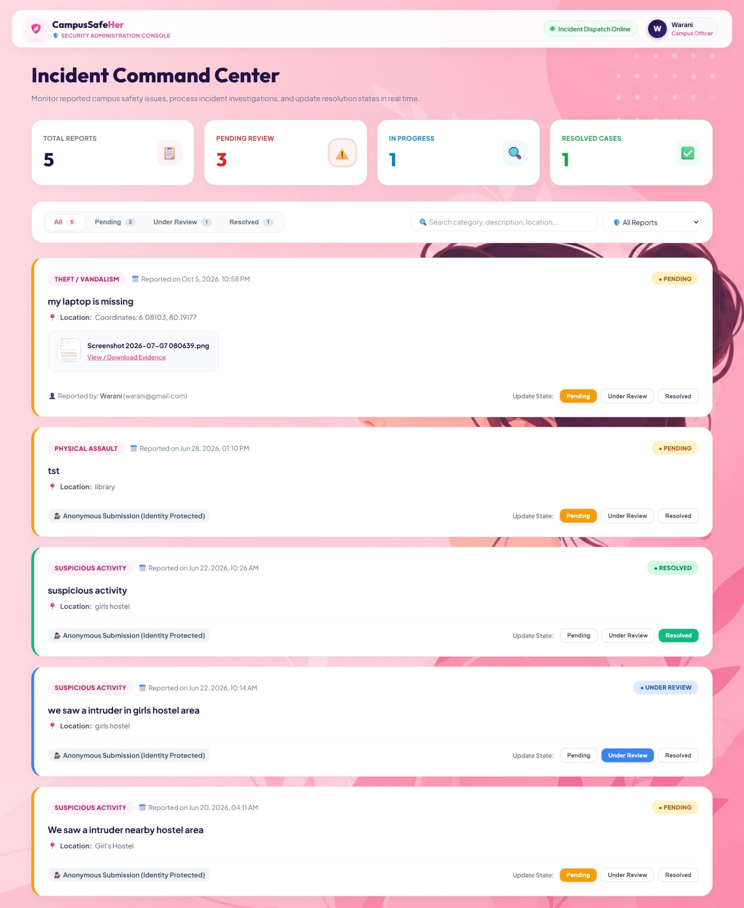

