# CampusSafeHer 🌸
### A Smart Campus Safety Platform for Female University Students

CampusSafeHer is a full-stack web application designed to improve the safety of female university students through emergency assistance, trusted contact management, incident reporting, safety check-ins, and AI-powered safety support.

🌐 **Live Application:** https://campus-safe-her.vercel.app

🎥 **Project Demonstration:** [Watch the Demo Video](YOUR_GOOGLE_DRIVE_DEMO_LINK)

---

## 📌 Table of Contents

- [Problem Statement](#-problem-statement)
- [Solution Overview](#-solution-overview)
- [Key Features](#-key-features)
- [Technologies Used](#-technologies-used)
- [System Architecture](#-system-architecture)
- [Database Design](#-database-design)
- [User Interface Screenshots](#-user-interface-screenshots)
- [Installation and Setup](#-installation-and-setup)
- [Environment Variables](#-environment-variables)
- [Running the Application](#-running-the-application)
- [Deployment](#-deployment)
- [Competition](#-competition)

---

## 🚨 Problem Statement

Female university students may face safety concerns when travelling alone, returning to hostels late, or requiring immediate assistance during emergencies.

Traditional communication methods may not always provide an organized and timely way to request help, notify trusted contacts, or report safety-related incidents.

CampusSafeHer aims to address these challenges through a centralized digital platform that supports emergency assistance, personal safety monitoring, and incident reporting.

## 💡 Solution Overview

CampusSafeHer provides an accessible web-based platform where students can manage trusted contacts, send SOS alerts, create safety check-ins, report incidents, and receive AI-powered safety assistance.

The platform also provides administrative functionality to support incident management and safety monitoring.

The application is designed with a responsive user interface to improve accessibility across different devices.

---

## ✨ Key Features

### 1. User Authentication
- Student registration and login.
- Secure password hashing using bcrypt.
- JWT-based authentication.
- Role-based access for students and administrators.

### 2. Emergency SOS Alerts
- Send emergency SOS alerts.
- Include geographical coordinates with an SOS alert.
- Store SOS alert information for tracking and management.
- Notify relevant users through the notification system.

### 3. Trusted Contact Management
- Manage trusted contacts.
- Associate trusted contacts with user accounts.
- Support communication with trusted users during safety-related situations.

### 4. Safety Check-Ins
- Create safety check-ins with a destination and expected arrival time.
- Track check-in status.
- Manage reminders and overdue check-ins.
- Generate notifications for safety alerts and safe confirmations.

### 5. Incident Reporting
- Submit safety-related incident reports.
- Record incident categories, descriptions, and locations.
- Support anonymous incident reporting.
- Attach supporting files where supported.
- Track incident status.

### 6. AI-Powered Safety Assistant
- Provide AI-powered safety assistance using the Google Gemini API.
- Support users with safety-related guidance.
- Generate complaint letters where the relevant feature is available.

### 7. Administrative Dashboard
- Provide administrative access.
- Support incident management.
- Present safety-related information for administrative monitoring.

### 8. Responsive User Interface
- Provide a user-friendly interface.
- Support navigation across the main application pages.
- Improve usability on different screen sizes.

---

## 🛠 Technologies Used

| Component | Technologies |
|---|---|
| Frontend | React, Vite, React Router DOM, Axios |
| Backend | Node.js, Express.js |
| Database | MongoDB Atlas, Mongoose |
| Authentication | JSON Web Tokens (JWT), bcryptjs |
| AI Integration | Google Gemini API |
| Background Tasks | Node Cron |
| Middleware and Configuration | CORS, dotenv |
| Version Control | Git, GitHub |
| Frontend Deployment | Vercel |
| Backend Deployment | Render |

---

## 🏗 System Architecture

CampusSafeHer follows a client-server architecture.

1. **Frontend:** The React application provides the user interface and sends API requests to the backend.
2. **Backend:** The Node.js and Express.js server processes API requests, handles application logic, and manages authentication.
3. **Database:** MongoDB Atlas stores user accounts, trusted contacts, incidents, SOS alerts, check-ins, and notifications.
4. **AI Integration:** The backend integrates with the Google Gemini API to provide AI-powered functionality.
5. **Deployment:** The frontend is deployed using Vercel, while the backend is intended to run on Render.

### Architecture Diagram


If your architecture image is stored in the `screenshots` folder instead, use:

`./screenshots/Architectural%20diagram.png`

Keep only the path that matches your actual repository.

---

## 🗄 Database Design

CampusSafeHer uses MongoDB Atlas with Mongoose for database management.

The application contains seven main Mongoose models:

| Model | Purpose |
|---|---|
| `User` | Stores user account information and roles. |
| `TrustedContact` | Associates users with their trusted contacts. |
| `Incident` | Stores reported safety incidents. |
| `SOS` | Stores emergency SOS alerts and geographical coordinates. |
| `CheckIn` | Stores safety check-ins, arrival times, locations, and reminder status. |
| `SOSNotification` | Stores notifications associated with SOS alerts. |
| `CheckInNotification` | Stores notifications associated with safety check-ins. |

### Entity Relationship Diagram (ERD)

The following diagram illustrates the relationships between the application's Mongoose models.

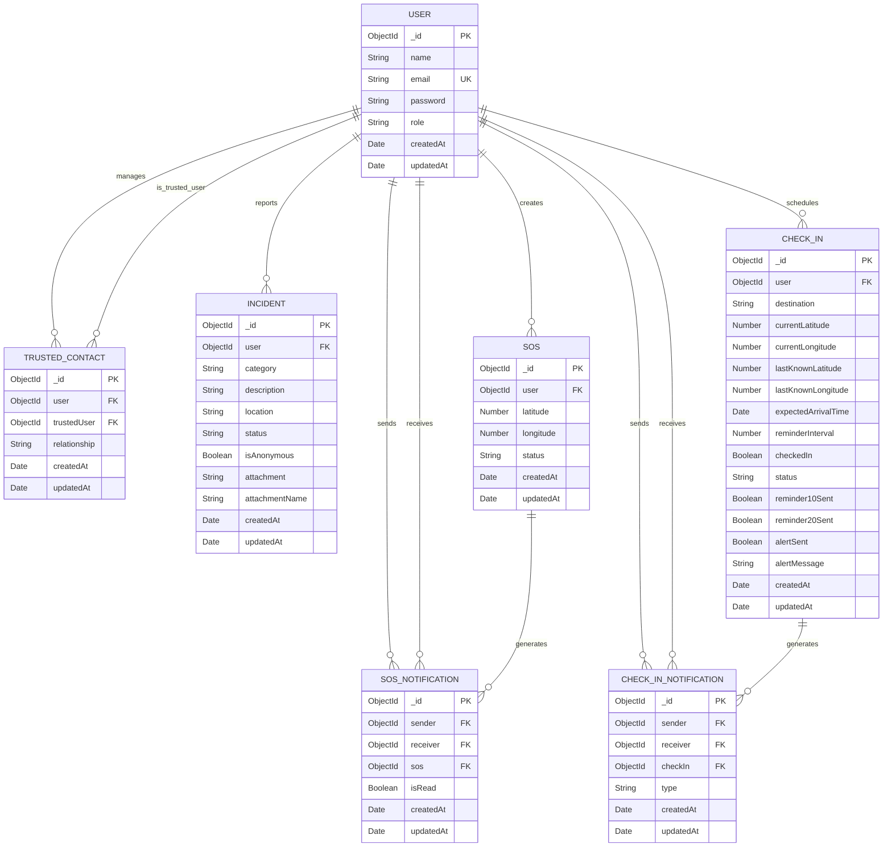

**Note:** `PK`, `FK`, and `UK` are explanatory labels in the diagram. MongoDB uses document identifiers and Mongoose references rather than relational-database foreign-key constraints.

A static ERD image is also available in the `screenshots` folder:


---

## 🖥 User Interface Screenshots

The following screenshots demonstrate the main interfaces of CampusSafeHer.

> Ensure that each image filename matches the actual filename in your repository. Update or remove entries if your filenames differ.

### Home Page

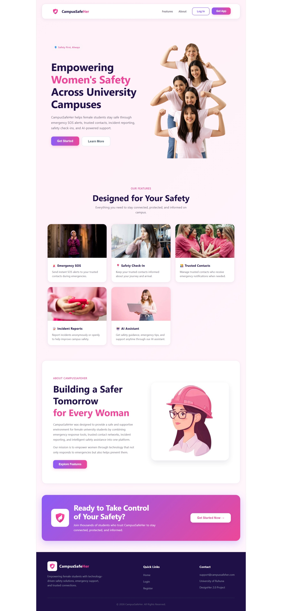

### Login Page

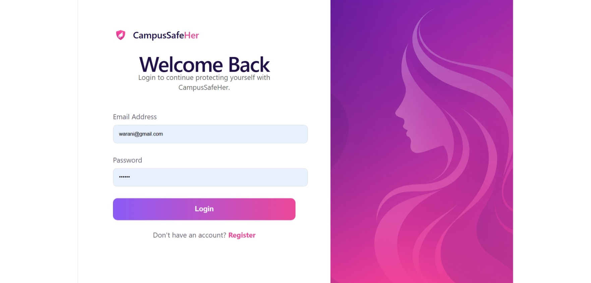

### Registration Page

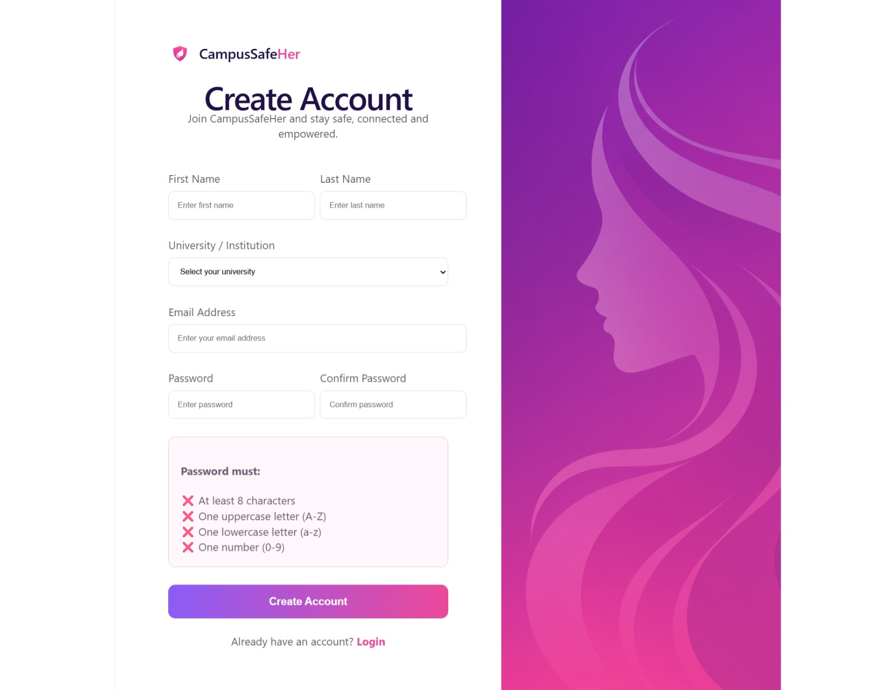

### Student Dashboard

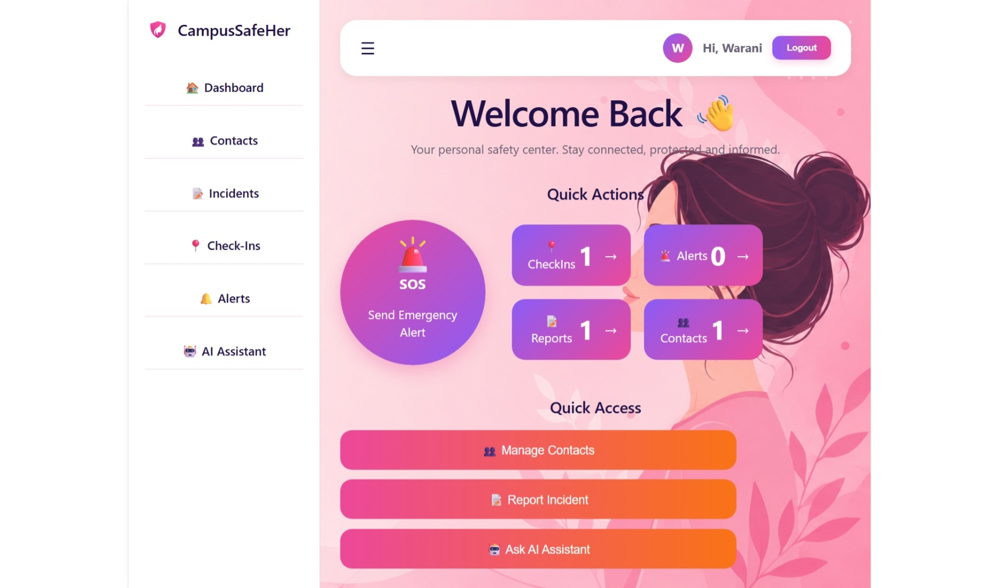

### Trusted Contacts

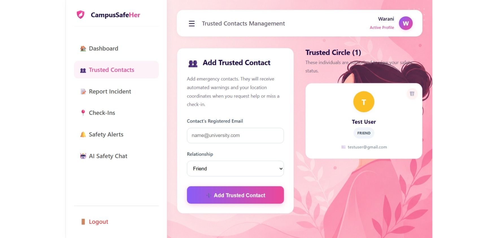

### Incident Reporting

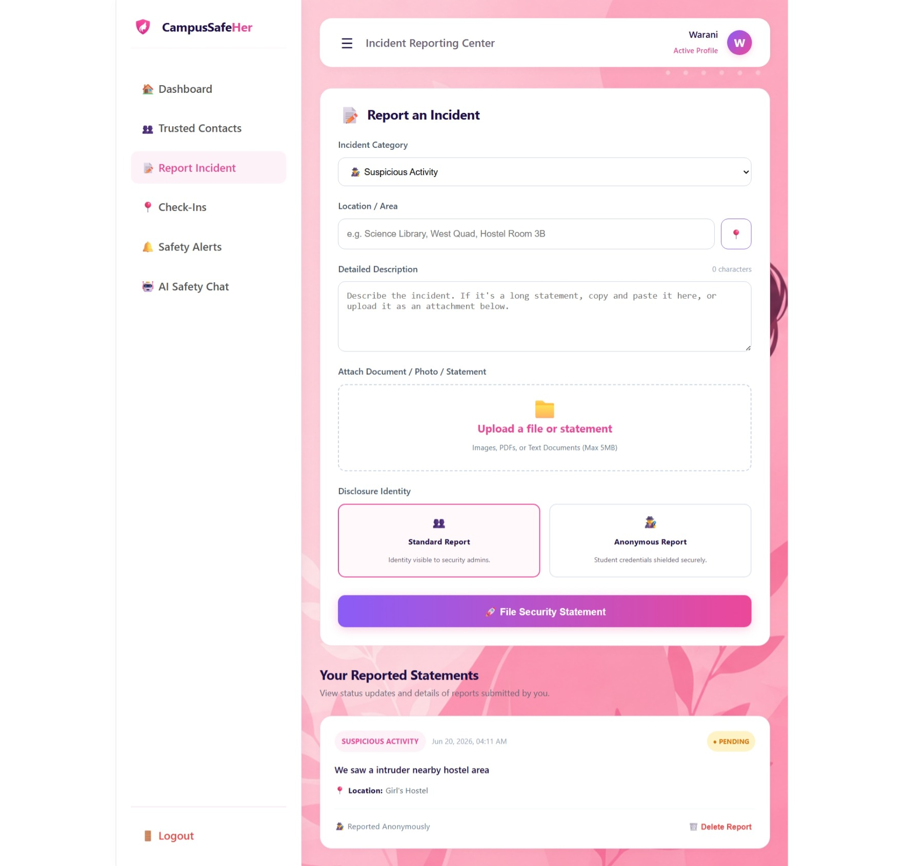

### Safety Check-Ins

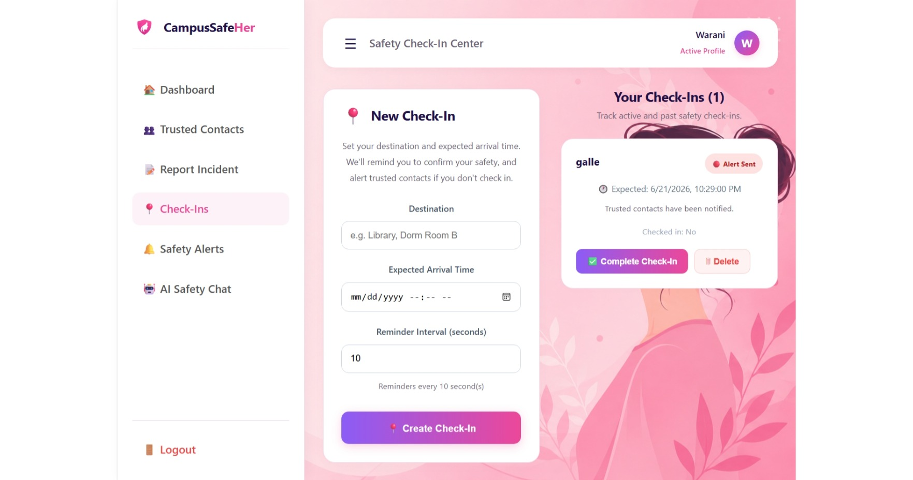

### Emergency Alerts

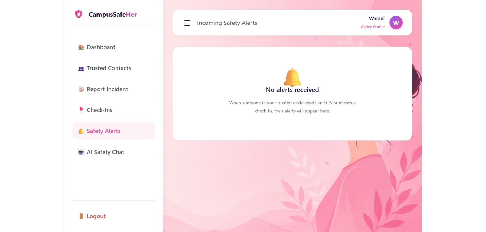

### AI Safety Assistant

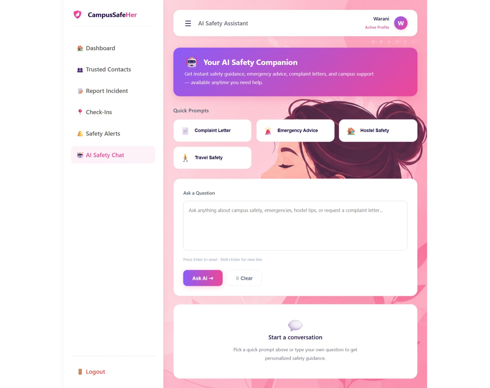

### Administrative Dashboard

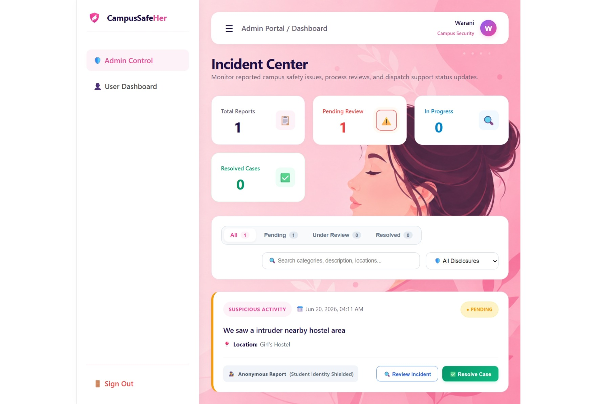

---

## ⚙ Installation and Setup

Follow these instructions to run CampusSafeHer locally.

### Prerequisites

Install the following software before starting:

- Node.js and npm
- Git
- A MongoDB Atlas account or another compatible MongoDB deployment
- A code editor such as Visual Studio Code

### 1. Clone the Repository

```bash
git clone https://github.com/WaraniLakma/CampusSafeHer.git
cd CampusSafeHer
```

### 2. Set Up the Backend

Navigate to the backend directory:

```bash
cd backend
npm install
```

Create a `.env` file inside the `backend` directory and configure the required environment variables using the instructions below.

Start the backend:

```bash
npm start
```

The backend uses port `5000` by default when the `PORT` environment variable is not configured.

### 3. Set Up the Frontend

Open a second terminal from the project root and navigate to the frontend directory:

```bash
cd frontend
npm install
```

Create a `.env` file inside the `frontend` directory:

```env
VITE_API_URL=http://localhost:5000/api
```

Start the frontend development server:

```bash
npm run dev
```

Open the local address printed by Vite in your terminal. The default address is:

`http://localhost:5173`

---

## 🔐 Environment Variables

### Backend Environment Variables

Create `backend/.env` and configure the environment variables required by your backend.

At minimum, the database configuration uses:

```env
MONGODB_URI=your_mongodb_connection_string
PORT=5000
```

Add the JWT secret and Google Gemini API key using the **exact variable names expected by your backend code**. Check the authentication and AI service files before adding them.

Do not commit actual database credentials, API keys, or authentication secrets to GitHub.

### Frontend Environment Variables

Create `frontend/.env`:

```env
VITE_API_URL=http://localhost:5000/api
```

For a deployed frontend, configure `VITE_API_URL` with your deployed backend's API base URL, ending in `/api`.

---

## ▶ Running the Application

Start the backend and frontend in separate terminals.

**Backend terminal:**

```bash
cd backend
npm start
```

**Frontend terminal:**

```bash
cd frontend
npm run dev
```

To build the frontend for production:

```bash
cd frontend
npm run build
```

The production build is generated by Vite in the frontend's `dist` directory.

---

## ☁ Deployment

CampusSafeHer uses the following deployment approach:

| Component | Platform |
|---|---|
| Frontend | Vercel |
| Backend | Render |
| Database | MongoDB Atlas |

**Live frontend:** https://campus-safe-her.vercel.app

For a successful deployment, configure the appropriate environment variables, ensure that the backend accepts requests from the deployed frontend origin, and verify that the backend can connect to MongoDB Atlas.

---

## 🏆 Competition

CampusSafeHer was developed in connection with **DesignHer 2.0**, a workshop and competition for female undergraduate students of the Faculty of Engineering, University of Ruhuna.

The project explores how full-stack web development and AI integration can contribute to improving student safety and emergency assistance.

---

## 👩‍💻 Repository

**GitHub Repository:** https://github.com/WaraniLakma/CampusSafeHer

---

*CampusSafeHer — Supporting safer journeys through technology.*